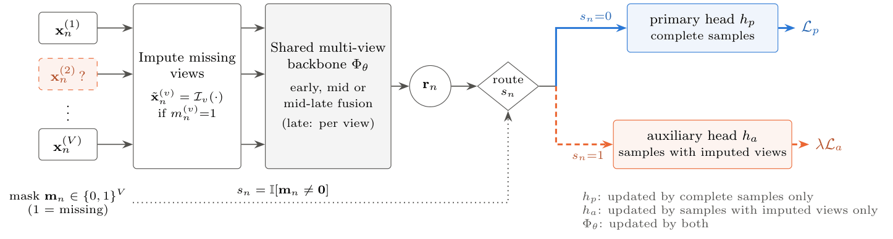

* Two-Head Routing for Incomplete Multi-View Classification
Code for the paper /Multi-head architecture for robust imputation-based partial multi-view classification/ (B. Lauwers, F. Faramarzi Lighvan, L. Houthuys; Vrije Universiteit Brussel), submitted to /Information Fusion/. The code started as a master's thesis (Applied Sciences and Engineering: Computer Science, VUB) and was re-implemented for the paper. 

** Abstract
Imputing missing views and training one classifier on the resulting mixture of real and imputed samples forces a single decision boundary to fit two different input distributions. We route complete samples to a primary head and samples with imputed views to an auxiliary head on top of a shared multi-view backbone, using the observed missingness mask at training and inference time. We evaluate this on ModelNet40, SensIT Vehicle, UCI-HAR and YouTube Multiview Video Games with four imputers, three fusion types (early, mid, late) and four missing rates. See the paper for the results.

** Two-Head Multi-Task Architecture

** Structure
#+begin_src text
  .
  ├── data/features                  # datasets go here (not in the repo, see below)
  ├── data/img                       # architecture figure
  ├── pyproject.toml, uv.lock        # dependencies
  └── src
      ├── centralized                # experiments of the paper
      │   ├── main.py                # entry point for single experiments
      │   ├── experiments.py         # experiment logic
      │   ├── train.py, utils.py, config.py, data_setup.py
      │   ├── hparam_search.py       # two-stage hyperparameter search
      │   ├── paper_stats.py         # per-seed results, paired tests, gain-vs-MSE
      │   ├── gradient_analysis.py   # gradient cosine and norm-ratio tracking
      │   ├── imputation_mse.py      # imputation error per imputer
      │   ├── run_experiments.sh     # full run of the paper experiments
      │   └── run_yt_experiments.sh  # same for YouTube
      └── core                       # models and imputers
          ├── models.py              # early/mid/late fusion, single-head and two-head
          ├── cpm_nets.py, dcp_nets.py
          ├── data.py, datasets.py, train.py, utils.py
#+end_src

** Reproducing the Experiments
*** Environment Setup
This repo uses [[https://github.com/astral-sh/uv][uv]] for Python dependency management.

#+begin_src bash
  # Install dependencies and create a virtual environment
  uv sync
  source .venv/bin/activate
#+end_src

*** Data Preparation
Due to size and licensing restrictions, the raw datasets and extracted feature matrices are not included in this repository. To run the experiments, please download the respective files from their official sources and place them in the ~data/~ directory as outlined below.

*1. ModelNet40*
- *Source:* [[https://github.com/iMoonLab/HGNN][iMoonLab/HGNN GitHub Repository]]
- *Instructions:* Navigate to the "Usage" section of their README and download the ~ModelNet40_mvcnn_gvcnn_feature~ file (hosted on Google Drive).
- *Placement:* Save the ~.mat~ file as ~data/features/ModelNet40_mvcnn_gvcnn.mat~.

*2. SensIT Vehicle (Acoustic/Seismic)*
- *Source:* [[https://www.csie.ntu.edu.tw/~cjlin/libsvmtools/datasets/multiclass.html][LIBSVM Data Repository]]
- *Instructions:* Scroll to the "SensIT Vehicle (acoustic)" and "SensIT Vehicle (seismic)" sections. Download the training and testing files for both modalities.
- *Placement:* Save the four files (~acoustic~, ~acoustic.t~, ~seismic~, ~seismic.t~) in ~data/features/sensit_vehicle_features/~.

*3. UCI Human Activity Recognition (UCI-HAR)*
- *Source:* [[https://archive.ics.uci.edu/dataset/240/human+activity+recognition+using+smartphones][UCI Machine Learning Repository - HAR]]
- *Instructions:* Click "Download" and extract the ~.zip~ archive.
- *Placement:* Place the extracted contents into ~data/features/uci_har_dataset/~.

*4. YouTube Multiview Video Games Dataset*
- *Source:* [[https://archive.ics.uci.edu/dataset/269/youtube+multiview+video+games+dataset][UCI Machine Learning Repository - YouTube Multiview]]
- *Instructions:* Click "Download" and extract the ~.zip~ archive.
- *Placement:* Place the extracted contents into ~data/features/youtube/~.

*** Running the code
Run everything from ~src/~ (the scripts are modules of ~centralized~).

*Single experiment* (fusion types: ~early~, ~mid~, ~late~; ~--backbone_depth~ for the depth ablation):
#+begin_src bash
  cd src
  uv run python -m centralized.main --experiment generate_results --dataset har \
      --fusion_type mid --imputation_type zero --backbone_depth 1
#+end_src

*Hyperparameter search* (stage 1: lr and width on the single-head model, stage 2: lambda on the two-head model; tuning seeds 7, 11, 13):
#+begin_src bash
  uv run python -m centralized.hparam_search --help
#+end_src

*Per-seed accuracies, paired tests and gain vs. imputation error:*
#+begin_src bash
  uv run python -m centralized.paper_stats collect --datasets har --imputations zero gaus cpm dcp \
      --fusions early mid late --rates 0.1 0.3 0.5 0.7 --seeds 50 121 893 17 2024 --out per_seed_results.jsonl
  uv run python -m centralized.paper_stats table --inp per_seed_results.jsonl
  uv run python -m centralized.paper_stats gain_vs_mse --inp per_seed_results.jsonl --mse mse_results.json --fusion mid
#+end_src

*Imputation error and gradient analysis:*
#+begin_src bash
  uv run python -m centralized.imputation_mse --datasets har --imputations zero gaus cpm dcp --missing_rate 0.5 --seeds 50 121 893 --out mse_results.json
  uv run python -m centralized.gradient_analysis run --dataset har --imputation zero --missing_rate 0.5 --fusion mid --seeds 50 121 893
  uv run python -m centralized.gradient_analysis summarize --dataset har --imputation zero --missing_rate 0.5 --fusion mid
#+end_src

The full set of paper experiments is in ~src/centralized/run_experiments.sh~.

** Disclaimer
Almost all this code is written by hand and went through multiple phases while writing my thesis/paper, except for the final experiment scripts. Everything is tested on an Arch Linux machine, but it is possible that some features or experiments need some small changes to make them work as expected. This is research code, not an optimized or perfectly written Python package.

** Citation
#+begin_src bibtex
  @article{lauwers2026twohead,
    title   = {Multi-head architecture for robust imputation-based partial multi-view classification},
    author  = {Lauwers, Brecht and Faramarzi Lighvan, Farnaz and Houthuys, Lynn},
    journal = {Information Fusion},
    year    = {2026},
    note    = {Under review. TODO: update with volume, pages and DOI}
  }
#+end_src

** License
This paper is licensed under the MIT License. See the ~LICENSE~ file for details.
